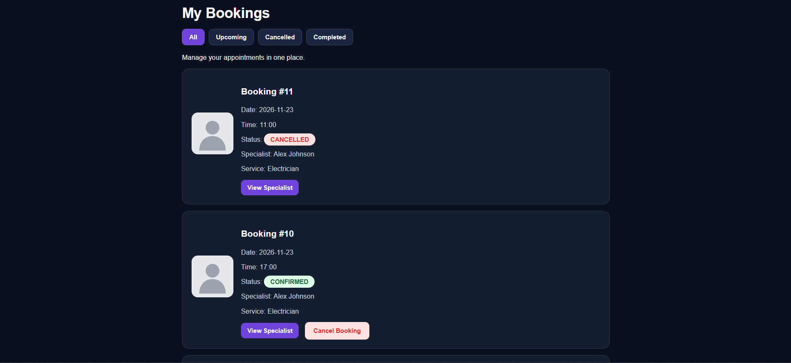
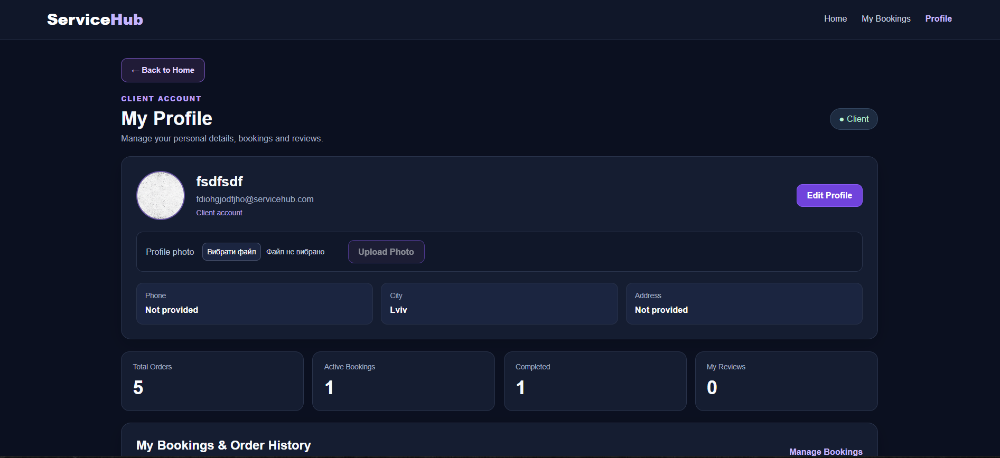
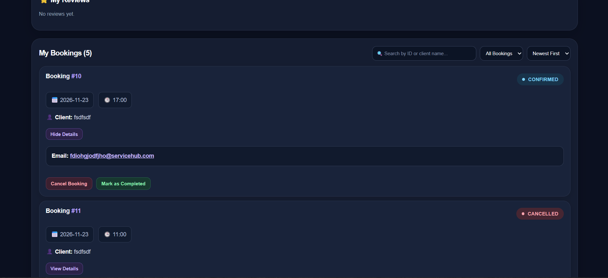
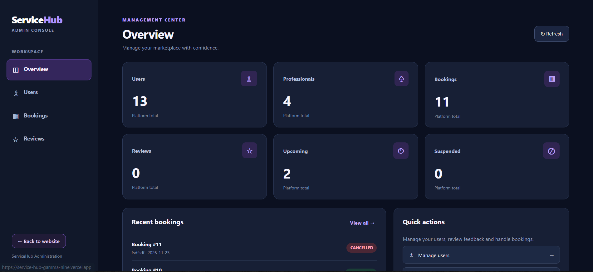
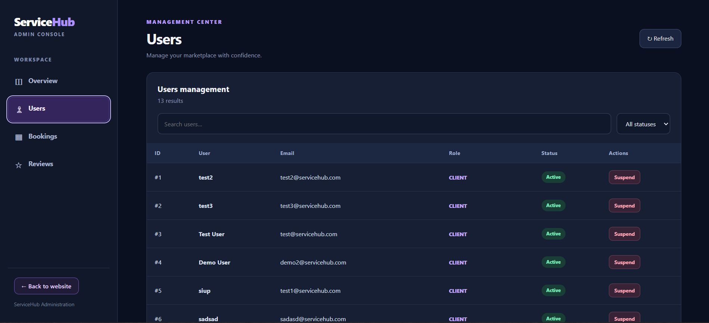
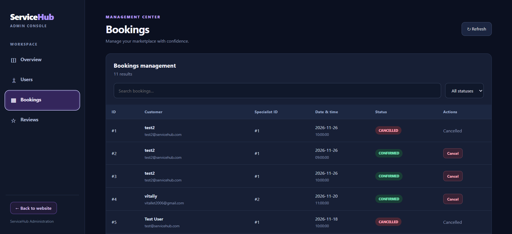
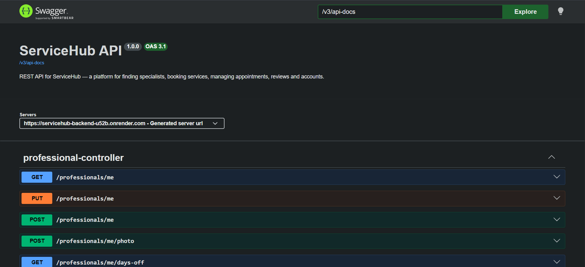
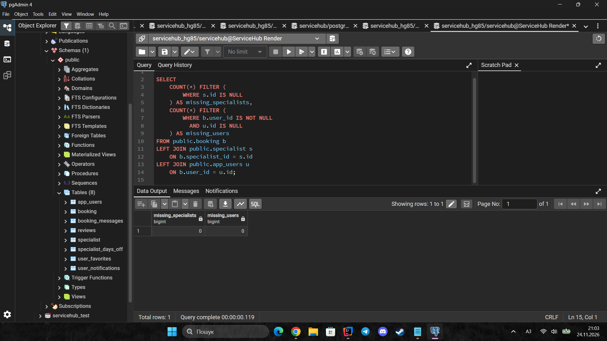

# ServiceHub — Full-Stack Service Booking Platform

**ServiceHub** is a full-stack web application that connects customers with service professionals, allowing users to discover services, schedule appointments, and manage bookings online.

Built with **Java, Spring Boot, React, and PostgreSQL**, this project demonstrates REST API development, authentication and authorization, relational database management, automated testing, and full-stack deployment.

### Live Demo

- **Website:** https://service-hub-gamma-nine.vercel.app/
- **GitHub Repository:** https://github.com/vitalilet/ServiceHub
- **Swagger API Documentation:** https://servicehub-backend-u52b.onrender.com/swagger-ui/index.html

*Note: The backend uses Render's free hosting tier and may take some time to respond after inactivity.*

---

## Tech Stack

| Layer | Technologies |
|---|---|
| Backend | Java, Spring Boot, Spring Security |
| Persistence | Spring Data JPA, Hibernate, PostgreSQL |
| Frontend | React, JavaScript, Vite, CSS |
| Authentication | Session-based authentication, BCrypt, CSRF protection |
| API | REST, JSON, OpenAPI / Swagger UI |
| Build | Maven, npm |
| Deployment | Docker, Render, Vercel |
| Testing | JUnit, Spring Boot Integration Tests |

## Key Features

### Customer Features

- Account registration and secure login
- Search professionals by service and city
- View professional profiles and service details
- Check available appointment dates and times
- Create and cancel bookings
- Track booking statuses
- View booking history
- Edit personal profile information
- Upload profile photos
- View and manage reviews

### Professional Features

- Dedicated professional dashboard
- Manage professional profile, description, pricing, and working hours
- Upload profile photos
- View customer appointments
- Search and filter bookings
- Cancel appointments or mark them as completed
- Manage days off
- View customer reviews
- Monitor booking statistics

### Administrator Features

- Administrative dashboard with platform statistics
- View and manage registered users
- Suspend user accounts
- Monitor bookings and their statuses
- Cancel bookings
- Review management interface
- Search and filter administrative records

## Screenshots

### Customer Experience

**My Bookings**



**Customer Profile**



### Professional Dashboard



### Administration Dashboard



**User Management**



**Booking Management**



### REST API Documentation



### PostgreSQL Database



---

## Backend Architecture

The backend follows a layered Spring Boot architecture:

- **Controllers** handle HTTP requests and expose REST endpoints.
- **DTOs** define request and response data structures.
- **Services and business logic** enforce application rules.
- **Repositories** provide database access through Spring Data JPA.
- **Entities** represent persistent application data.
- **Security configuration** controls authentication, authorization, and account access.

### Main API Areas

| API Area | Purpose |
|---|---|
| Authentication | Registration, login, logout, CSRF |
| Specialists | Search and retrieve professional profiles |
| Bookings | Appointment creation, availability, status management |
| Client Profiles | Customer account management |
| Professional Profiles | Professional settings and availability |
| Reviews | Customer feedback |
| Administration | User, booking, and review management |

Interactive API documentation is available through Swagger UI.

## Security

ServiceHub includes:

- BCrypt password hashing
- Session-based authentication
- Role-based authorization for CLIENT, PROFESSIONAL, and ADMIN
- CSRF protection
- Account status validation
- Protected endpoints
- Booking ownership and permission checks

## Booking System

The booking system includes business rules for:

- Professional working hours
- Appointment availability
- Prevention of duplicate bookings
- Booking status transitions
- Cancellation permissions
- Professional days off

## Database

ServiceHub uses PostgreSQL with Spring Data JPA and Hibernate.

Core data models include:

- Users
- Specialists
- Bookings
- Reviews
- Booking messages
- Specialist days off
- Favorites
- Notifications

The database maintains relationships between customer accounts, professionals, and appointments.

## Testing

The backend includes integration tests designed to verify:

- Authentication requirements
- Booking creation
- Double-booking prevention
- Working-hour restrictions
- Booking cancellation permissions
- Database constraints
- Session security and account role changes

## Project Structure

```text
servicehub/
├── src/
│   ├── main/
│   │   ├── java/com/servicehub/
│   │   │   ├── config/
│   │   │   ├── controller/
│   │   │   ├── dto/
│   │   │   ├── model/
│   │   │   └── repository/
│   │   └── resources/
│   └── test/
├── frontend/
│   ├── src/
│   └── public/
├── screenshots/
├── Dockerfile
├── compose.yaml
├── pom.xml
└── README.md
```

## Local Development

### Requirements

- Java 21+
- PostgreSQL
- Node.js and npm
- Maven or Maven Wrapper

### Backend Setup

1. Clone the repository.
2. Configure the PostgreSQL connection using the application's environment variables.
3. Start the Spring Boot application from IntelliJ IDEA or using the Maven Wrapper.

For Windows:

```bash
.\mvnw.cmd spring-boot:run
```

For Linux/macOS:

```bash
./mvnw spring-boot:run
```

### Frontend Setup

```bash
cd frontend
npm install
npm run dev
```

## Deployment

The application is deployed using:

- **Vercel** for the React frontend
- **Render** for the Spring Boot backend
- **PostgreSQL** for persistent data storage
- **Docker** for backend containerization

## Project Purpose

ServiceHub was developed as a portfolio project focused on practical **Java backend engineering**.

It demonstrates how a real-world service booking application can combine REST APIs, authentication, authorization, database persistence, booking business rules, frontend integration, and cloud deployment.